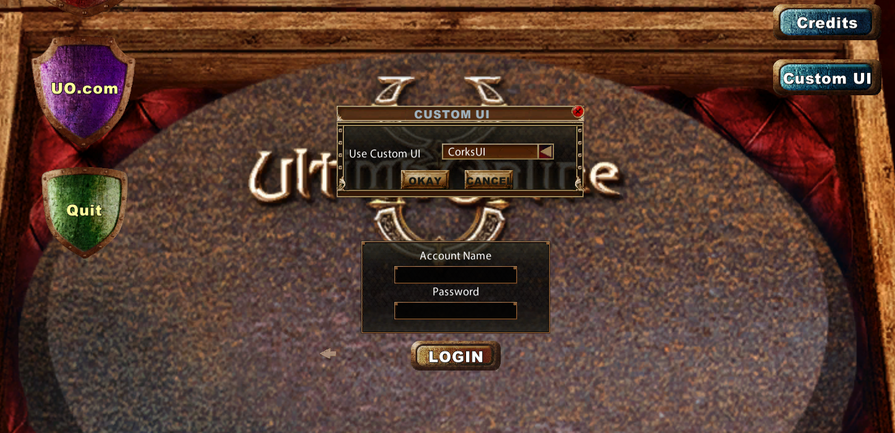
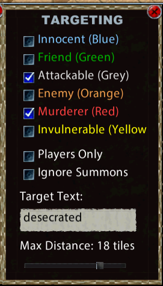
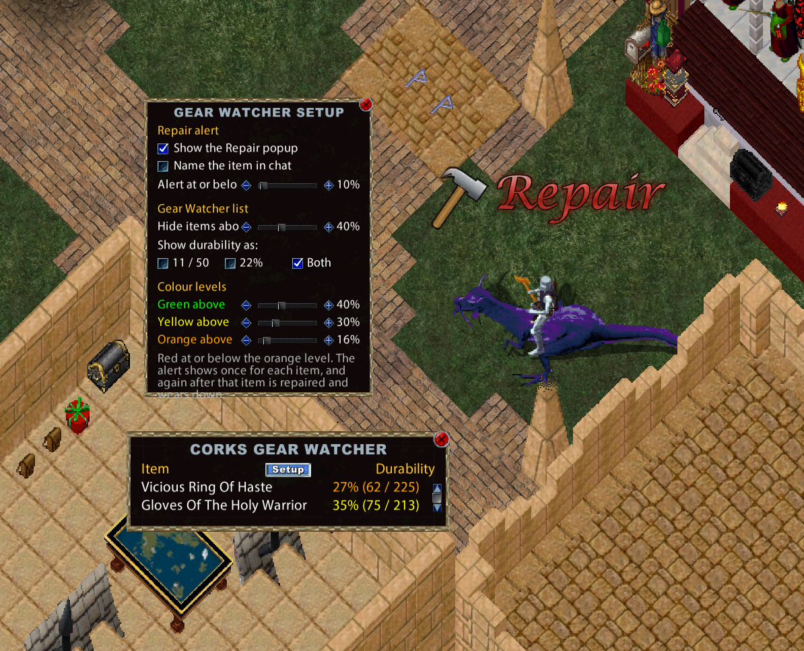
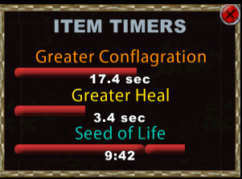
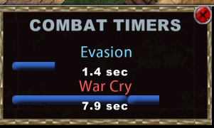
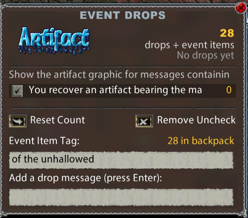
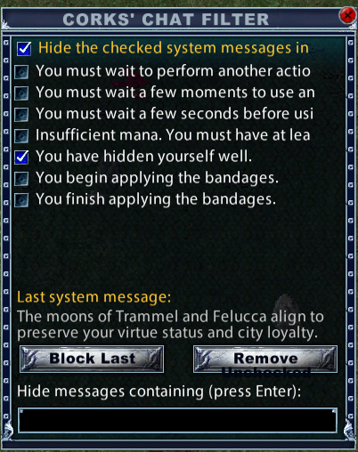
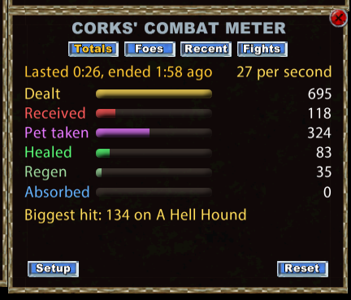
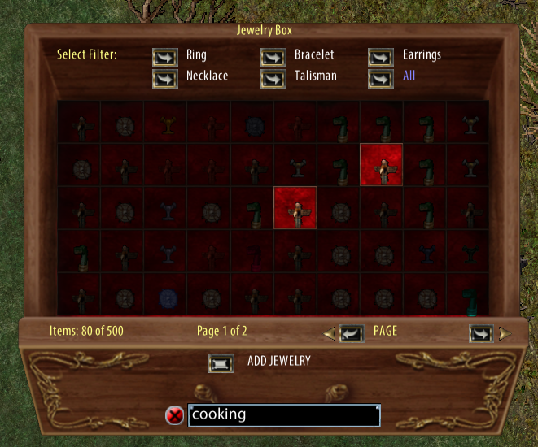

# CorksUI

Custom lightweight user interface additions for the **Ultima Online Enhanced Client**. CorksUI is built on top of the default UI and adds a scalable notoriety-aware targeting system, an equipment durability tracker, potion timers, a system message chat filter, center screen alerts, loot tags for containers, a combat meter and several Map Window improvements.

## Contents

- [Installation](#installation)
- [Features](#features)
  - [Corks' Targeting](#corks-targeting)
  - [Corks' Gear Watcher (Durability)](#corks-gear-watcher-durability)
  - [Consumable Timers](#consumable-timers)
  - [Combat Timers](#combat-timers)
  - [Event Tracker](#event-tracker)
  - [Corks' Chat Filter](#corks-chat-filter)
  - [Corks' Alerts](#corks-alerts)
  - [Corks' Loot Tags](#corks-loot-tags)
  - [Corks' Combat Meter](#corks-combat-meter)
  - [Jewelry Box Search](#jewelry-box-search)
  - [Map Window Changes](#map-window-changes)
  - [UOAM Bridge](#uoam-bridge)
- [Actions Reference](#actions-reference)
- [Saved Settings](#saved-settings)
- [File Layout](#file-layout)
- [Development Notes](#development-notes)

## Installation

1. Copy the `CorksUI` folder into your client's `UserInterface` folder, for example:
   `C:\...\Ultima Online Enhanced\UserInterface\CorksUI`
2. Start the client, open **Options → Interface**, and select **CorksUI** as the custom UI.

<p>
  
</p>

## Features

### Corks' Targeting

<p>
  
</p>

A configurable replacement for the Target Next, Nearest and Previous hotkeys. It only cycles through mobiles that pass the filters you pick.

**Opening the window:** Actions → **Corks' Addons** → **Targeting Gump**. Drag it to a hotbar to toggle the settings window. The window is closed by default. If it is open when you log out it opens again next time, until you close it. The targeting actions work whether or not it is open.

#### Filters

| Filter | What it does |
| --- | --- |
| Notoriety checkboxes | Choose which notorieties can be targeted: Innocent (Blue), Friend (Green), Can Attack (Grey), Criminal (Grey), Enemy (Orange), Murderer (Red), Invulnerable (Yellow). Each label is shown in its notoriety color. |
| Players Only | Skips pets, known creatures/NPCs (from the creature database) and invulnerable NPCs such as vendors, guards and healers. |
| Ignore Summons | Skips summoned creatures. |
| Name contains | Only targets mobiles whose name contains one of the words you type. Separate several with commas, e.g. `orc, lich, dragon`. Matching ignores case and matches part of a name (`lich` also matches "lich lord"). Leave it empty to turn it off. Press **Enter** to apply. |

All filters work together: a mobile has to pass every enabled filter to be targeted. You are never targeted yourself, and nothing 22 or more tiles away is considered.

#### Targeting actions

Found under Actions → Corks' Addons. Drag them to a hotbar or bind them to keys.

- **Target Nearest (Notoriety)**: the closest mobile that passes the filters.
- **Target Next (Notoriety)**: steps forward through the mobiles on screen, wrapping around at the end.
- **Target Previous (Notoriety)**: goes back through your target history, skipping any that no longer pass the filters.

Selecting a target this way does not pop up the context menu.

**Window controls:** right-click to close; use the mouse wheel over the window to scale it. It snaps to other windows and remembers its position.

### Corks' Gear Watcher (Durability)

<p>
  
</p>

A compact window that lists every equipped item that has durability, with its current and maximum value.

**Opening the window:** Actions → **Corks' Addons** → **Durability Gump**. The window is closed by default. If it is open when you log out it opens again next time, until you close it.

- It updates when your paperdoll changes and also refreshes every 10 seconds.
- The window resizes to fit the number of items.
- The durability value is colored by how much is left. These are the default levels; you can change them in Setup:

  | Remaining | Color |
  | --- | --- |
  | Over 75% | Green |
  | 51–75% | Yellow |
  | 26–50% | Orange |
  | 25% or less | Red |

- If nothing you're wearing has durability, it shows "No items with durability equipped."

**Repair alert:** when an equipped item wears down to your alert level, a "Repair" graphic with a hammer flashes in the middle of the screen, and a chat message names the item, for example "Gear Watcher: Platemail Tunic needs repair (22%, 11 / 50)." The alert shows once for each item, and again only after that item is repaired and wears down again. It works even while the Gear Watcher window is closed, checking every 10 seconds.

**Setup:** click **Setup**, between the Item and Durability headings, to open the Gear Watcher Setup window. Changes apply straight away and are saved. Each slider has a small **−** on its left and **+** on its right that move it by 1% for fine changes. The repair alert waits while the Setup window is open, so trying out the sliders doesn't set it off; it checks as soon as you close the window.

- **Repair alert**
  - **Show the Repair popup**: on by default.
  - **Name the item in chat**: also print the chat message naming the item; on by default.
  - **Alert at or below**: slider, 1–99% (25% by default).
- **Gear Watcher list**
  - **Hide items above**: slider that leaves out items in good shape, 1–100%. At 100% ("None", the default) every item is listed. If everything is hidden, the list says "All items are above X%."
  - **Show durability as**: `11 / 50` (default), `22%`, or both, `22% (11 / 50)`.
- **Colour levels**: sliders for where green, yellow and orange start (**Green above**, **Yellow above**, **Orange above**: 75 / 50 / 25% by default). Anything at or below the orange level is red. Each level stays below the one above it.

Type `/repairpopup` in chat to see the popup at any time.

**Window controls:** right-click to close; use the mouse wheel to scale it. It remembers its position and scale. The same goes for the Setup window.

### Consumable Timers

<p>
  
</p>

Double-clicking one of these potions or items adds a countdown to the **Item Timers** window:

| Potion | Countdown | When it starts |
| --- | --- | --- |
| Greater Heal | 10 sec | Once the potion stack you double-clicked goes down by one (or disappears, if it was your last), within 3 seconds of the double-click. At full health or while still on cooldown no potion is drunk, so it doesn't start the timer |
| Greater Conflagration | 30 sec | Once the potion stack you double-clicked goes down by one (or disappears, if it was your last), within 15 seconds of the double-click. A failed or cancelled throw doesn't use a potion, so it doesn't start the timer |
| Supernova | 2 min | Once the potion stack you double-clicked goes down by one (or disappears, if it was your last), within 3 seconds of the double-click |
| Barrab Hemolymph Concentrate (shown as "Barrab Hemolymph") | 20 min | Once the potion stack you double-clicked goes down by one (or disappears, if it was your last), within 3 seconds of the double-click |
| Seed of Life | 10 min | Once the seed stack you double-clicked goes down by one (or disappears, if it was your last), within 3 seconds of the double-click. At full health or while still on cooldown no seed is eaten, so it doesn't start the timer |
| Mana Draught | 10 min | Once the draught stack you double-clicked goes down by one (or disappears, if it was your last), within 3 seconds of the double-click. If no draught is drunk (while still on cooldown, for example), it doesn't start the timer |
| Stat Loss Removal | 10 min | Once the potion stack you double-clicked goes down by one (or disappears, if it was your last), within 3 seconds of the double-click. If no potion is drunk (while still on cooldown, for example), it doesn't start the timer |
| Healing Stone | 15 sec | Once the points left on the stone you double-clicked go down, within 3 seconds of the double-click. If the stone doesn't heal you, its points don't change, so it doesn't start the timer. When it starts, the Greater Heal timer starts too |
| Balm of Strength | 30 min | Once the balm stack you double-clicked goes down by one (or disappears, if it was your last), within 15 seconds of the double-click. Only one balm runs at a time: if you accept the prompt to replace your current balm, its timer is removed and the new one starts; if you decline, nothing changes. Using the same balm again restarts its timer |
| Balm of Swiftness | 30 min | Once the balm stack you double-clicked goes down by one (or disappears, if it was your last), within 15 seconds of the double-click. Only one balm runs at a time: if you accept the prompt to replace your current balm, its timer is removed and the new one starts; if you decline, nothing changes. Using the same balm again restarts its timer |
| Balm of Wisdom | 30 min | Once the balm stack you double-clicked goes down by one (or disappears, if it was your last), within 15 seconds of the double-click. Only one balm runs at a time: if you accept the prompt to replace your current balm, its timer is removed and the new one starts; if you decline, nothing changes. Using the same balm again restarts its timer |

Each running timer gets its own row, with the potion's name in the potion's color and a bar that is red while it counts down, then turns green and reads **Ready** for 3 seconds before the row is removed. Rows are sorted alphabetically by potion name. The window grows and shrinks to fit the running timers (up to 9) and shows "No active timers" when none are running.

Only double-clicks made in the UI count (backpack, container and paperdoll windows). Using a potion from a hotbar slot, a macro or an assistant program happens inside the client and doesn't start a timer.

**Window controls:** drag it where you want it (it remembers the position); use the mouse wheel over it to scale it; right-click it to close it. The window is closed by default: open it with the **Consumable Timers** action (Corks' Addons group) or `/script CorksTimers.Toggle()`. If it is open when you log out it opens again next time, until you close it. Timers keep counting while it is closed.

Timers are defined in the `CorksTimers.Timers` table at the top of `Source/CorksTimers.lua`. Add an entry there to time another item.

### Combat Timers

<p>
  
</p>

A second timer window, laid out like the potion timers, for combat abilities. A row appears when the ability's buff icon appears, and goes through three stages:

1. **Active** (blue bar): counts down the time the ability has left, taken from the buff icon.
2. **Cooldown** (red bar): starts when the buff ends and counts down until you can use the ability again.
3. **Ready** (green bar): shown for 3 seconds, then the row is removed.

| Ability | Cooldown |
| --- | --- |
| Evasion | 20 sec |
| War Cry | 20 min |
| Rejuvenate (Chivalry mastery) | 1 hour |

Evasion and War Cry follow their buff icons. Rejuvenate is instant and has no buff icon, so its row skips the active stage: the cooldown starts when the game message "You feel completely rejuvenated!" arrives. Either way it works however you use the ability: hotbar, macro or spellbook.

**Opening the window:** Actions → **Corks' Addons** → **Combat Timers**. The window is closed by default. If it is open when you log out it opens again next time, until you close it. Timers keep counting while it is closed.

**Window controls:** drag it where you want it (it remembers the position); use the mouse wheel over it to scale it; right-click it to close it.

Abilities are defined in the `CorksCombatTimers.Timers` table at the top of `Source/CorksCombatTimers.lua`, each with its cooldown and either the id of its buff icon (`buffId`) or the game message that shows it was used (`triggerTexts`).

### Event Tracker

<p>
  
</p>

The default UI shows the artifact graphic over your head when certain game messages arrive, such as "A special gift has been placed in your backpack." Event drops that use a different message don't trigger it. The **Event Tracker** window shows the graphic for your event's drops too, and counts them.

- **Event Item Tag:** type text that appears in the event's drop messages and in its items' names, for example `Unhallowed`, and press Enter. Separate several with commas. Capitals don't matter. Clear the box and press Enter to stop counting.
- **Artifact Count:** when a game message containing a tag arrives, the artifact graphic shows, the drop is counted, and the count flashes for a moment. How long ago the last drop was shows at the right of the reward points' expiry line, and your drops per hour at the right of the reward points line. The rate counts drops since you logged in or reloaded the UI (or pressed **Reset Count**, so press it when you start a farming run), not items found in the backpack, and shows "--" for the first 5 minutes. The count is for this session (it starts again after logging in or reloading the UI); **Reset Count** sets it back to 0.
- While the count is 0, the window checks your backpack every few seconds, including bags inside it, and starts the count from the items with a tag in their name, so drops from before the count started aren't missed. A stack counts as its amount. Once the count is above 0, only drop messages add to it. Bags you haven't opened since logging in may not be counted.
- **Reward points:** open the event vendor (for example the Treasures of the Unhallowed vendor) and the lines under the header show your reward points, how much they've changed this session, and when they expire. The points are read from the vendor's "Your Reward Points" line, so they only update while that gump is open, even if the Event Tracker window is closed. The last value is saved and shown as "(last visit)" until you open the vendor again. The event's name, read from the same gump, shows under the window's title (blank until you've visited the vendor).
- **Luck:** your current luck shows under the Reset Event button and updates every second, so you can check your luck gear while farming.
- **Shard and Facet:** the line under the Event Item Tag box shows the shard you logged in to on the left and the facet you're in on the right. The client only knows the shard by a number, so CorksUI names it from a list in `CorksEventTracker.SHARD_NAMES` (`Source/CorksEventTracker.lua`): Atlantic, Baja, Catskills, Chesapeake, Great Lakes, Lake Superior, Legends, Siege Perilous and Test Center so far. Other shards show their number until they're added; the comment above the list has a chat command that prints a shard's number.
- **Reset Event:** starts over for a new event. It clears the Event Item Tag, the event name, the saved reward points and the Artifact Count (with the drops per hour and last drop).

Only game messages count, so a player typing the tag won't show the graphic. Any game message containing the tag counts as a drop, so pick text that only appears in drop messages and item names. Drops whose message already shows the artifact graphic through [Corks' Alerts](#corks-alerts) are counted, but the graphic isn't shown a second time.

**Opening the window:** Actions → **Corks' Addons** → **Event Tracker**. The window is closed by default. If it is open when you log out it opens again next time, until you close it. Drops are counted while it is closed.

**Window controls:** right-click to close; use the mouse wheel to scale it. It remembers its position and scale.

### Corks' Chat Filter

<p>
  
</p>

Choose which game messages are kept out of the chat window and off your character's head.

**Opening the window:** Actions → **Corks' Addons** → **Chat Filter**. The window is closed by default. If it is open when you log out it opens again next time, until you close it. The filter keeps working while it is closed.

- **Hide the checked system messages in chat** (the gold check box at the top) turns the whole filter on or off. It's on by default. Turning it off puts the chat window straight back to the game's own log.
- **Checked rows are hidden.** The list starts with a few common messages (all unchecked), such as "You must wait to perform another action." and the bandage messages. Click a check box or its text to turn it on or off. The change applies straight away.
- **Block Last** hides the last system message shown under "Last system message". It also catches game messages that aren't system messages, like "You have hidden yourself well." Messages with a cliloc number are matched by that number, so blocking a message that names an item or player hides that message whatever name it shows. Messages without a number are matched on their full text.
- **Hide messages containing:** type part of a message and press **Enter** to hide every system message containing it. Matching ignores case.
- **Remove Unchecked** removes the unchecked rows you added. The starting rows always stay.

Row colors: white rows are the starting list, gold rows were added with Block Last and blue "Contains:" rows are text matches. The list holds up to 30 rows.

Only game messages are filtered: system messages, and any message with a cliloc number. Some game messages come on other channels, such as "You have hidden yourself well.", which arrives as your character saying it. What players type never has a cliloc number, so speech, party and guild chat are never hidden. A hidden message is kept out of the chat window and the journal and isn't drawn over your character's head, but the rest of the UI still reads it, so potion timers, buff tracking and spell messages keep working.

#### How it filters the chat window

The client's chat window shows the game's own `Chat` log, and the UI can't remove lines from it. So while the filter is on, CorksUI copies every line of that log into its own `CorksChat` log, leaving out the blocked messages, and the chat window tabs show `CorksChat` instead. Tab filters, channel colors and saved tab settings carry over.

- Lines get the time they were copied as their timestamp, which is normally the same second.
- Blocking a message hides it from then on; lines already in chat stay.
- If copying ever fails, the chat window goes back to the game's log and a message in chat says why.
- For troubleshooting, set `CorksChatFilter.DEBUG = true` near the top of `Source/CorksChatFilter.lua`. Each message, each chat line copied or skipped, and the tabs moved to the copy are then written to `logs/CorksChatFilter.log` in the client folder.

**Window controls:** right-click to close; use the mouse wheel to scale it. It remembers its position and scale.

### Corks' Alerts

Flashes a graphic in the middle of the screen when something happens that's easy to miss in chat, like being revealed, hit by a Death Strike or bumping into a stealther. The same window turns the default UI's own center screen alerts on or off.

**Opening the window:** Actions → **Corks' Addons** → **Alerts**. The window is closed by default. If it is open when you log out it opens again next time, until you close it. The alerts keep working while it is closed.

- **Checked alerts are shown.** All are on to start with, except **Vice vs Virtue battle**. Click a check box to turn an alert on or off.
- **Click an alert's name** to see its graphic.
- **All On** and **All Off** change every alert at once.

| Group | Alerts |
| --- | --- |
| Things done to you | You can move again (also after untangling), Webbed, Turned to stone, Slowed, Panic, You are disarmed, Calmed, Stripped, Hit by Death Strike, Revealed, Blood Oath on you, Honor wears off |
| Your attacks | Target splintered, Target disarmed |
| Nearby | Something hidden nearby, Bumped a stealther, Meteor, Trade route ambush |
| Loot | Artifact for valor, Special gift, Minax artifact, Fellowship artifact, Cult and lost kingdom treasure, Reward put in your backpack, Trick or treat (from your last target), Cargo crate, Lava rock |
| Events | Void Pool battle begins, Void Pool battle lost, Vice vs Virtue battle, Minax's Beacon vulnerable, Volcano eruption, Krampus spotted |
| Items | Gorgon lenses crumble, Bone machete snaps, Luck ran out, Orange petals wore off, Container full |
| Server | Server going down, A GM is talking to you |

The loot alerts show the default UI's artifact graphic. Most of the others have their own graphic. Only game messages trigger an alert, so a player typing the same words doesn't. Low Life and Low Pet Life aren't in the list; they keep the default UI's own settings.

Event Tracker shows the artifact graphic for drops matching your Event Item Tag. If an alert above already shows it for that message, it isn't shown twice. If you turned that alert off, Event Tracker still shows it, because the drop matched your tag.

**Window controls:** right-click to close; use the mouse wheel to scale it. It remembers its position and scale.

### Corks' Loot Tags

Marks items in containers shown in grid view, so the good drops in a corpse stand out. Each item gets a short tag in the corner of its slot and a colored slot:

| Tag | Item | Slot color |
| --- | --- | --- |
| `SP20` | Splintering weapon, with its % | Cyan |
| `PARA` | Reactive paralyze | Red |
| `mA`, `LA`, `GA`, `MA`, `LGND` | Minor, lesser, greater, major or legendary artifact | Green, green, yellow, orange, purple |
| `AR11` | Artifact rarity, with its number | Green to purple as the rarity goes up |
| `mM`, `LM`, `GM`, `MM` | Minor, lesser, greater or major magic item (off to start with) | Blue |
| (none) | An item containing one of your highlight words | Gold |

When an item matches more than one, the tag shows the first in this list. A highlight word decides the slot color. Stacks and items with charges keep showing their amount or charges.

**Opening the window:** Actions → **Corks' Addons** → **Loot Tags**. The window is closed by default. If it is open when you log out it opens again next time, until you close it. Containers are tagged while it is closed.

- **Tag items in container grid view** turns the whole feature on or off. **Show a short tag on the item** and **Tint the item's slot** turn each half on or off.
- **Tag these:** pick which kinds of items are tagged. Click a check box or its text to change it.
- **Highlight items containing:** type part of an item's name or properties and press **Enter**. Items containing it get a gold slot, e.g. `totem of the tribe` or `hit lightning`. Matching ignores case. Up to 10 words; uncheck words to turn them off, and **Remove Unchecked** takes them out of the list.

Items are tagged from their properties. An item whose properties haven't arrived from the server yet is tagged when they arrive. Matching uses the English property text. List view isn't tagged.

**Window controls:** right-click to close; use the mouse wheel to scale it. It remembers its position and scale.

### Corks' Combat Meter

<p>
  
</p>

Sums up each fight: damage dealt, damage per second, biggest hit, damage taken by you and your pet, healing and absorbed damage. It also changes the damage numbers over heads.

**Opening the window:** Actions → **Corks' Addons** → **Combat Meter**. The window is closed by default. If it is open when you log out it opens again next time, until you close it. Fights are recorded while it is closed.

- **A fight** starts with the first damage number and ends after 10 seconds without one. The window shows the fight in progress, or the last one.
- **Tabs** along the top show one page at a time. The current tab's name is gold, and the window remembers it.
- **Totals:** the fight's length and damage per second, then a colored bar for each total: Dealt, Received (damage you took), Pet taken (damage your pet took; its own hits count in Dealt), Healed, Regen and Absorbed. The bars share one scale, so you can compare them at a glance. Below them, the biggest hit and what it hit.
- **Foes:** up to seven enemies that took the most damage, each with a bar showing its share of the damage dealt, e.g. `1,871 (91%)`.
- **Recent:** the last eight hits and heals. The **Dealt**, **Received**, **Pet** and **Heals** check boxes pick what's listed.
- **Fights:** the fight in progress and the last 3 fights, with their damage and damage per second, and bars comparing them. Click one to show it on the Totals tab.
- **Reset** clears the fights and the recent list. Fights are kept until you reset, reload the UI or log out.

**Damage dealt is your group's damage.** The client sends a damage number without saying who dealt it. Hits by you, your pets and other players fighting with you all arrive the same way, so they're all counted. Fight alone for your own damage. Damage taken by you and by your pet is always exact.

**Healing** is worked out from your hit points, so it includes potions, spells, bandages and life leech. A rise at least as big as **Heals from** counts as healing and shows as a green number over your head, like `+52`. Smaller rises count as regeneration. A hit and a heal in the same moment are told apart by matching the drop to the damage number. **Absorbed** damage comes from the game's "point(s) of damage have been absorbed" message, and shows as a blue number in brackets, like `(12)`.

**Setup** (the button at the bottom left) changes the damage numbers over heads:

- **Hide small damage numbers and enlarge big hits** turns the two settings below on or off.
- **Hide numbers below:** numbers smaller than this aren't drawn (still counted). Off by default.
- **Big hits from:** numbers at least this big are drawn half as large again. Off by default.
- **Heals from:** the smallest hit point rise counted as a heal (5 by default).
- **Show heals over your head** and **Show absorbed damage over your head** turn those numbers on or off.

The colors of the stock damage numbers stay as set in the client's options.

**Window controls:** right-click to close; use the mouse wheel to scale it. It remembers its position and scale.

### Jewelry Box Search

<p>
  
</p>

A search box appears over the bottom of a jewelry box whenever you open one. Type words from an item's name or properties, e.g. `luck`, `mana regeneration` or `gold ring`, and the items on the page that don't match are covered with a dark square. Several words must all match, in any order. Each word must match a whole word, so `ring` finds a Gold Ring but not Earrings, and `10` doesn't match `100`. Matching ignores case. Click the red **X** on the left of the box, or press **Escape**, to clear the search.

The jewelry box only sends the page you're looking at, so other pages can't be searched until you view them. Each page you view is remembered while the box stays open. Hover over the search box to see the matches on this page, the matches on each other page you've viewed, and the pages not viewed yet, e.g. `This page: 2 | Page 3: 1 | Not viewed: 4`. Use the box's own page buttons to go to them.

- Picking a filter (Ring, Bracelet, …) or adding or taking out an item changes the page layout, so the remembered pages are cleared and you'll need to view them again.
- Closing the box clears the search box and the remembered pages. Changing page or filter, or taking an item out, doesn't: the box closes and reopens for those too, but the search carries over.
- Items whose properties haven't arrived from the server yet aren't covered, and are counted as "Loading" until they arrive.

### Map Window Changes

`Source/MapWindow.lua` replaces the default Map Window with these changes:

- **Player position logging:** your facet and X/Y coordinates are written to `logs/pos.log` while the map updates, for use by external mapping tools.
- **Map title** "Atlas" is shown again.
- **Dragging is kept within the map's borders**, so you can't drag the view off the edge of the map.
- **Zoom:** your saved zoom level is restored when the map opens, with an adjusted default if none is saved.
- The combo box, lock and tilt settings are saved between sessions.

### UOAM Bridge

`Tools/UOAMBridge/uoam_bridge.py` lets [UOAM](https://uoguide.com/UOAM) (UO Automap) follow an Enhanced Client player, so EC players appear on a shared UOAM map alongside classic client and ClassicUO players. It can also show the other players in your UOAM group on the EC's own Atlas and radar.

UOAM can't read the Enhanced Client directly. It gets positions through the UOAssist interface: a hidden window called `UOASSIST-TP-MSG-WND` that answers requests for the player's coordinates. ClassicUO and Razor provide that window; the EC doesn't. The bridge provides it, answering with the position the EC writes to `logs/pos.log` (see [Map Window Changes](#map-window-changes)).

**Using it:**

1. Log in to the EC.
2. Download `CorksUOAMBridge.exe` from the [Releases page](https://github.com/DaggerfordTechnologies/CorksUI_UltimaOnline_EnhancedClient/releases) and put it in `Tools/UOAMBridge`. Run the bridge by double-clicking it. It has Python built in, so nothing needs installing.

   If you have [Python](https://www.python.org/downloads/) 3.8 or newer, you can run the script instead: double-click `Start UOAM Bridge.bat`, or from a command prompt in that folder run `py uoam_bridge.py`.

   The bridge finds `logs/pos.log` from its own location, so keep it in `Tools/UOAMBridge`. If you moved it, give the path: `CorksUOAMBridge.exe --log "D:\...\Ultima Online Enhanced\logs\pos.log"`. Other options (`--verbose`, `--hub`) work the same for the `.exe` and the script.
3. If Windows or your antivirus warns about `CorksUOAMBridge.exe`, that's common for programs packaged this way that aren't signed. You can run the script with Python instead.
4. Start UOAM and link it to **server `127.0.0.1`, port `2000`**, with your usual name and password. The bridge passes the link on to the UOAM hub (`uoamhub.classicuo.org`, port 443) unchanged, so UOAM works as usual, and the other players also appear on the EC map. If your group uses another hub, start the bridge with `--hub host:port`.

   Linking UOAM straight to the hub also works, but then the other players only show in UOAM, not on the EC map.

UOAM follows you as you move. UOAM doesn't pick up facet changes from the bridge, so when it's linked through the bridge, the bridge corrects your facet in the updates UOAM sends to the hub, and the rest of the group sees you on the right one. If UOAM was already running, it connects to the bridge by itself within a few seconds.

Leave the bridge window open while you play; it should say `Ready` and then `UOAM connected`. Close it, or press **Ctrl+C** in it, to stop. Only one UOAssist window can be open at a time, so close UOAssist or Razor first; the bridge says so if one is already open.

**Other players on the EC map:** each player in your UOAM group who is on the facet you're viewing appears on the Atlas and radar as a light blue party icon with their name. Hover over one for their location. They update about every 5 seconds, as UOAM fetches them from the hub, and disappear about 30 seconds after the bridge or UOAM is closed. The bridge writes them to `logs/CorksUOAMBridge.txt`, and `Source/CorksUOAMBridge.lua` reads that file. Players on Ter Mur aren't shown, because UOAM has no code for that facet.

**What works:** position and facet. **What doesn't:** height is always reported as 0, and other UOAssist features (stats, skills, macros) aren't supported. Text UOAM sends to the game, such as UOAM chat, is printed in the bridge window, because the EC can't receive text from outside programs.

`--verbose` prints every request UOAM sends, which helps if something isn't working.

## Actions Reference

Custom actions use IDs **6100–6149** in `Source/ActionsWindow.lua`.

| ID | Name | Group | Script |
| --- | --- | --- | --- |
| 6100 | Target Nearest (Notoriety) | Corks' Addons | `CorksTargeting.NearTarget()` |
| 6101 | Target Next (Notoriety) | Corks' Addons | `CorksTargeting.NextTarget()` |
| 6102 | Target Previous (Notoriety) | Corks' Addons | `CorksTargeting.PrevTarget()` |
| 6103 | Targeting Gump | Corks' Addons | `CorksTargeting.Toggle()` |
| 6104 | Durability Gump | Corks' Addons | `CorksDurabilityGump.Toggle()` |
| 6105 | Chat Filter | Corks' Addons | `CorksChatFilter.Toggle()` |
| 6106 | Consumable Timers | Corks' Addons | `CorksTimers.Toggle()` |
| 6107 | Combat Timers | Corks' Addons | `CorksCombatTimers.Toggle()` |
| 6108 | Event Tracker | Corks' Addons | `CorksEventTracker.Toggle()` |
| 6109 | Alerts | Corks' Addons | `CorksAlerts.Toggle()` |
| 6110 | Loot Tags | Corks' Addons | `CorksLootTags.Toggle()` |
| 6111 | Combat Meter | Corks' Addons | `CorksCombatMeter.Toggle()` |

You can also run any of these from a macro or the chat line with `/script <function>`.

Type `/reloadui` on the chat line to reload the UI (the same as `/script InterfaceCore.ReloadUI()`). Unlike a plain reload, it keeps your buff and debuff icons: the server only sends them when they start or at login, so CorksUI saves them before reloading and puts them back afterwards, with their timers adjusted.

## Saved Settings

Settings are stored in the client's normal interface settings, so each character keeps its own.

| Setting | Feature |
| --- | --- |
| `CorksTargetingNoto2` – `CorksTargetingNoto8` | Notoriety checkboxes |
| `CorksTargetingPlayersOnly` | Players Only |
| `CorksTargetingIgnoreSummons` | Ignore Summons |
| `CorksTargetingNameFilter` | Name filter text |
| `CorksChatFilterEnabled` | Chat Filter on/off |
| `CorksChatFilterPreset<cliloc>` | Chat Filter starting rows (checked or not) |
| `CorksChatFilterCount`, `CorksChatFilterId<n>`, `CorksChatFilterText<n>`, `CorksChatFilterOn<n>` | Chat Filter rows you added |
| `CorksAlert<name>` | Each Corks' Alerts row on or off, e.g. `CorksAlertrevealed` |
| `CorksLootTagsEnabled`, `CorksLootTagsLabels`, `CorksLootTagsTint`, `CorksLootTagsArtifact`, `CorksLootTagsRarity`, `CorksLootTagsSplinter`, `CorksLootTagsPara`, `CorksLootTagsMagic` | Loot Tags options |
| `CorksLootTagsWordCount`, `CorksLootTagsWord<n>`, `CorksLootTagsWordOn<n>` | Loot Tags highlight words |
| `CorksCombatMeterNumbers`, `CorksCombatMeterMinDamage`, `CorksCombatMeterBigHit`, `CorksCombatMeterHealMin`, `CorksCombatMeterHealNumbers`, `CorksCombatMeterAbsorbNumbers` | Combat Meter number settings |
| `CorksCombatMeterShowDealt`, `CorksCombatMeterShowTaken`, `CorksCombatMeterShowPet`, `CorksCombatMeterShowHeals` | Combat Meter recent list filters |
| `CorksTargetingWindowOpen`, `CorksDurabilityGumpOpen`, `CorksTimersOpen`, `CorksCombatTimersOpen`, `CorksEventTrackerWindowOpen`, `CorksChatFilterOpen`, `CorksAlertsOpen`, `CorksLootTagsOpen`, `CorksCombatMeterOpen` | Whether each Corks window was open at logout |
| `CorksEventTrackerItemName` | Event Tracker Event Item Tag |
| `CorksEventTrackerRewardPoints`, `CorksEventTrackerRewardEvent`, `CorksEventTrackerRewardExpires` | Event Tracker reward points last read from the event vendor |
| `MapZoom`, `MapWindowLocked`, `ShowMapCombos`, `MapWindowTilt` | Map Window |

Window positions and scales are saved through the standard `WindowUtils` helpers.

## File Layout

```text
CorksUI/
├── Interface.xml              Loads all UI files, including the Corks additions
├── Interface.lua              Creates the Corks windows at startup, feeds journal text to both timer windows, the drop alerts, the center screen alerts and the chat filter, installs the alert and loot tag hooks, and runs the chat log copy each frame
├── Source/
│   ├── ActionsWindow.lua      Adds the custom actions (IDs 6100–6111) to the Actions menu
│   ├── CorksTargeting.lua     Targeting filters and Next/Nearest/Previous logic
│   ├── CorksTargeting.xml     Targeting settings window
│   ├── CorksDurabilityGump.lua  Gear Watcher logic
│   ├── CorksDurabilityGump.xml  Gear Watcher window (19 rows defined up front)
│   ├── CorksTimers.lua        Potion timers: double-click trigger, journal checks, countdown
│   ├── CorksTimers.xml        Item Timers window (9 rows defined up front)
│   ├── CorksCombatTimers.lua  Combat timers: Evasion, War Cry and Rejuvenate, driven by buff icons and game messages
│   ├── CorksCombatTimers.xml  Combat Timers window (4 rows defined up front)
│   ├── CorksEventTracker.lua  Event Tracker: artifact graphic and session count for an Event Item Tag, reward points
│   ├── CorksEventTracker.xml  Event Tracker window
│   ├── CorksChatFilter.lua    Chat filter: matching, saved rows, window, filtered copy of the chat log
│   ├── CorksChatFilter.xml    Corks' Chat Filter window (30 rows defined up front)
│   ├── CorksJewelrySearch.lua Jewelry box search: reads the open box's items, matching, remembered pages, covers
│   ├── CorksJewelrySearch.xml Jewelry box search bar and the cover template
│   ├── CorksUOAMBridge.lua    Other UOAM players on the Atlas and radar, read from the UOAM Bridge's file
│   ├── CorksAlerts.lua        Center screen alerts: game messages, switching stock alerts off, window
│   ├── CorksAlerts.xml        Corks' Alerts window (50 rows defined up front)
│   ├── CorksLootTags.lua      Loot tags: reads item properties, tags and tints container grid slots, window
│   ├── CorksLootTags.xml      Corks' Loot Tags window (20 rows defined up front)
│   ├── CorksCombatMeter.lua   Combat meter: damage numbers, heals from hit points, absorbs, fights, window
│   ├── CorksCombatMeter.xml   Corks' Combat Meter window (meter and setup panels)
│   ├── CorksCombatDump.lua    /combatdump: records what the client sends for damage (dev tool)
│   ├── CorksTextures.xml      Textures added by CorksUI (Repair popup, alert graphics)
│   └── MapWindow.lua          Map Window changes
├── Textures/
│   └── cst_*.dds              Repair popup and alert graphics
└── Tools/
    ├── AlertTextures/
    │   └── make_alert_textures.py  Makes the Corks' Alerts graphics (not loaded by the client)
    └── UOAMBridge/
        ├── uoam_bridge.py     UOAM Bridge: lets UOAM follow the EC player (not loaded by the client)
        ├── uoam_relay.py      Relays UOAM's hub link and reads the group's positions from it
        ├── Start UOAM Bridge.bat  Double-click launcher for the bridge script (needs Python)
        ├── CorksUOAMBridge.exe    The bridge with Python built in (from Releases or build_exe.bat; not in git)
        └── build_exe.bat          Rebuilds CorksUOAMBridge.exe after changing the bridge
```

## Development Notes

A few things about the client's Lua environment that come up when working on this UI:

- **Strings vs. wide strings:** `type()` returns `"string"` for both plain strings and wide strings (`L"..."`), so it can't tell them apart. `CorksTargeting.ToWString()` checks with `wstring.len` instead. Use the `wstring.*` functions on names and text-box contents.
- **Window scaling:** calling `WindowSetDimensions` on a child of a window that isn't at 1.0 scale resets the scale of windows created at runtime with `CreateWindowFromTemplate`. That's why the Gear Watcher's rows are defined in XML rather than created from Lua.
- **Keep new features from breaking old ones:** set up the existing controls first, and wrap optional code in `pcall`, so one failing feature can't leave a window empty. Corks' Targeting reports name-filter errors in the chat window.
- **Lua error logging** is off by default in the client, so `logs/lua.log` is usually empty.
- **Checking changes outside the game** needs Lua 5.1 (`lua5.1`, `luac5.1`) and, optionally, `luacheck`. From the CorksUI folder:
  - `luac5.1 -p Source/*.lua Interface.lua` checks syntax.
  - `luacheck .` looks for misspelled names and accidental globals. `.luacheckrc` lists the client's and the default UI's globals.
  - `lua5.1 tests/test_chatfilter.lua` runs the chat filter tests against stand-ins for the client's chat log, overhead text and settings functions. It runs everything twice, once for a chat log that counts entries from 0 (what the client does) and once from 1 (what the docs say).
  - `lua5.1 tests/test_jewelrysearch.lua` runs the jewelry box search tests.
  - `lua5.1 tests/test_uoambridge.lua` runs the tests for reading the UOAM Bridge's player file.
  - `lua5.1 tests/test_alerts.lua` runs the Corks' Alerts tests. They also check that each alert graphic is listed in `CorksTextures.xml` and its file is the size `CorksAlerts.TEXTURES` says.
  - `lua5.1 tests/test_loottags.lua` runs the Loot Tags tests against a stand-in for the stock container code.
  - `lua5.1 tests/test_combatdump.lua` runs the `/combatdump` tests.
  - `lua5.1 tests/test_combatmeter.lua` runs the Combat Meter tests, including the orders hit points and damage numbers arrived in during real fights.
- **`/combatdump`** (dev tool) records what the client sends for damage. Type it in chat to start and again to stop. Each damage number (with every field of the client's `Damage` table, the mobile's name and whether it's your target) and each change to your own hit points is written to `logs/CorksCombatDump.log`, and stopping prints a summary in chat.
- **Changing the alert graphics:** edit the text, font or colors in `Tools/AlertTextures/make_alert_textures.py` and run it with Python 3 and Pillow (`pip install pillow`). It writes the `.dds` files to `Textures/` and prints their sizes; copy any new sizes into `CorksAlerts.TEXTURES`. It also writes `preview.png` next to the script so you can check them by eye.
- **Rebuilding the UOAM Bridge `.exe`:** after changing `uoam_bridge.py` or `uoam_relay.py`, run `Tools/UOAMBridge/build_exe.bat`. It installs PyInstaller into `%TEMP%\CorksUOAMBridgeBuild` the first time, not into your own Python, and writes a new `CorksUOAMBridge.exe` next to the script. The `.exe` is left out of git (`.gitignore`); attach it to a GitHub release instead.
- **The client differs from its docs in places:** `TextLogGetEntry` counts from 0, and `WStringToString` errors on a number. Errors inside the message handlers are swallowed by `pcall`, so mistakes like these show up as features silently doing nothing.
