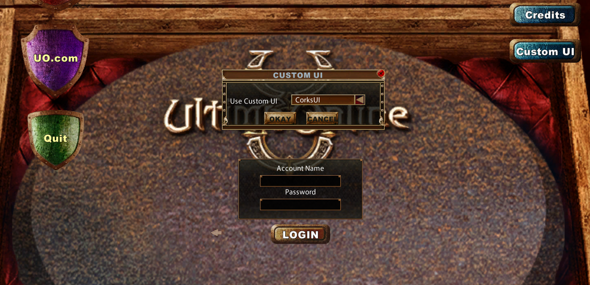
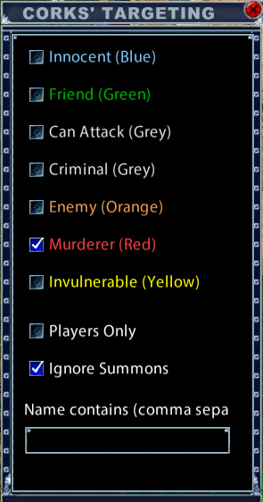
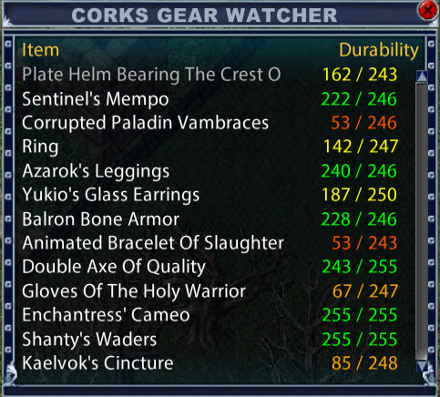
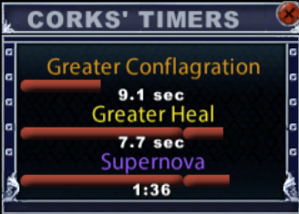
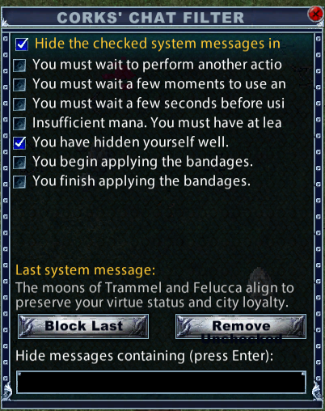

# CorksUI

Custom lightweight user interface additions for the **Ultima Online Enhanced Client**. CorksUI is built on top of the default UI and adds a scalable notoriety-aware targeting system, an equipment durability tracker, potion timers, a system message chat filter and several Map Window improvements.

## Contents

- [Installation](#installation)
- [Features](#features)
  - [Corks' Targeting](#corks-targeting)
  - [Corks' Gear Watcher (Durability)](#corks-gear-watcher-durability)
  - [Potion Timers](#potion-timers)
  - [Corks' Chat Filter](#corks-chat-filter)
  - [Map Window Changes](#map-window-changes)
- [Actions Reference](#actions-reference)
- [Saved Settings](#saved-settings)
- [File Layout](#file-layout)
- [Development Notes](#development-notes)

## Installation

1. Copy the `CorksUI` folder into your client's `UserInterface` folder, for example:
   `C:\...\Ultima Online Enhanced\UserInterface\CorksUI`
2. Start the client, open **Options → Interface**, and select **CorksUI** as the custom UI.

<p>
  
</p>

## Features

### Corks' Targeting

<p>
  
</p>

A configurable replacement for the Target Next, Nearest and Previous hotkeys. It only cycles through mobiles that pass the filters you pick.

**Opening the window:** Actions → **Targeting** → **Corks' Targeting**. Drag it to a hotbar to toggle the settings window.

#### Filters

| Filter | What it does |
| --- | --- |
| Notoriety checkboxes | Choose which notorieties can be targeted: Innocent (Blue), Friend (Green), Can Attack (Grey), Criminal (Grey), Enemy (Orange), Murderer (Red), Invulnerable (Yellow). Each label is shown in its notoriety color. |
| Players Only | Skips pets, known creatures/NPCs (from the creature database) and invulnerable NPCs such as vendors, guards and healers. |
| Ignore Summons | Skips summoned creatures. |
| Name contains | Only targets mobiles whose name contains one of the words you type. Separate several with commas, e.g. `orc, lich, dragon`. Matching ignores case and matches part of a name (`lich` also matches "lich lord"). Leave it empty to turn it off. Press **Enter** to apply. |

All filters work together: a mobile has to pass every enabled filter to be targeted. You are never targeted yourself, and nothing 22 or more tiles away is considered.

#### Targeting actions

Found under Actions → Targeting. Drag them to a hotbar or bind them to keys.

- **Target Nearest (Notoriety)**: the closest mobile that passes the filters.
- **Target Next (Notoriety)**: steps forward through the mobiles on screen, wrapping around at the end.
- **Target Previous (Notoriety)**: goes back through your target history, skipping any that no longer pass the filters.

Selecting a target this way does not pop up the context menu.

**Window controls:** right-click to close; use the mouse wheel over the window to scale it. It snaps to other windows and remembers its position.

### Corks' Gear Watcher (Durability)

<p>
  
</p>

A compact window that lists every equipped item that has durability, with its current and maximum value.

**Opening the window:** Actions → **Equipment** → **Corks' Gear Watcher**.

- It updates when your paperdoll changes and also refreshes every 10 seconds.
- The window resizes to fit the number of items.
- The durability value is colored by how much is left:

  | Remaining | Color |
  | --- | --- |
  | Over 75% | Green |
  | 51–75% | Yellow |
  | 26–50% | Orange |
  | 11–25% | Dark orange |
  | 10% or less | Red |

- If nothing you're wearing has durability, it shows "No items with durability equipped."

**Window controls:** right-click to close; use the mouse wheel to scale it. It remembers its position and scale.

### Potion Timers

<p>
  
</p>

Double-clicking one of these potions or items adds a countdown to the **Corks' Timers** window:

| Potion | Countdown | When it starts |
| --- | --- | --- |
| Greater Heal | 10 sec | Once the potion stack you double-clicked goes down by one (or disappears, if it was your last), within 3 seconds of the double-click. At full health or while still on cooldown no potion is drunk, so it doesn't start the timer |
| Greater Conflagration | 30 sec | Once the potion stack you double-clicked goes down by one (or disappears, if it was your last), within 15 seconds of the double-click. A failed or cancelled throw doesn't use a potion, so it doesn't start the timer |
| Supernova | 2 min | Once the potion stack you double-clicked goes down by one (or disappears, if it was your last), within 3 seconds of the double-click |
| Barrab Hemolymph Concentrate (shown as "Barrab Hemolymph") | 20 min | Once the potion stack you double-clicked goes down by one (or disappears, if it was your last), within 3 seconds of the double-click |
| Seed of Life | 10 min | Once the seed stack you double-clicked goes down by one (or disappears, if it was your last), within 3 seconds of the double-click. At full health or while still on cooldown no seed is eaten, so it doesn't start the timer |
| Mana Draught | 10 min | Once the draught stack you double-clicked goes down by one (or disappears, if it was your last), within 3 seconds of the double-click. If no draught is drunk (while still on cooldown, for example), it doesn't start the timer |
| Stat Loss Removal | 10 min | Once the potion stack you double-clicked goes down by one (or disappears, if it was your last), within 3 seconds of the double-click. If no potion is drunk (while still on cooldown, for example), it doesn't start the timer |
| Healing Stone | 15 min | Once the points left on the stone you double-clicked go down, within 3 seconds of the double-click. If the stone doesn't heal you, its points don't change, so it doesn't start the timer |
| Balm of Strength | 30 min | Once the balm stack you double-clicked goes down by one (or disappears, if it was your last), within 15 seconds of the double-click. Only one balm runs at a time: if you accept the prompt to replace your current balm, its timer is removed and the new one starts; if you decline, nothing changes. Using the same balm again restarts its timer |
| Balm of Swiftness | 30 min | Once the balm stack you double-clicked goes down by one (or disappears, if it was your last), within 15 seconds of the double-click. Only one balm runs at a time: if you accept the prompt to replace your current balm, its timer is removed and the new one starts; if you decline, nothing changes. Using the same balm again restarts its timer |
| Balm of Wisdom | 30 min | Once the balm stack you double-clicked goes down by one (or disappears, if it was your last), within 15 seconds of the double-click. Only one balm runs at a time: if you accept the prompt to replace your current balm, its timer is removed and the new one starts; if you decline, nothing changes. Using the same balm again restarts its timer |

Each running timer gets its own row, with the potion's name in the potion's color and a bar that is red while it counts down, then turns green and reads **Ready** for 3 seconds before the row is removed. Rows are sorted alphabetically by potion name. The window stays open: it grows and shrinks to fit the running timers (up to 9) and shows "No active timers" when none are running.

Only double-clicks made in the UI count (backpack, container and paperdoll windows). Using a potion from a hotbar slot, a macro or an assistant program happens inside the client and doesn't start a timer.

**Window controls:** drag it where you want it (it remembers the position); use the mouse wheel over it to scale it.

Timers are defined in the `CorksTimers.Timers` table at the top of `Source/CorksTimers.lua`. Add an entry there to time another item.

### Corks' Chat Filter

<p>
  
</p>

Choose which game messages are kept out of the chat window and off your character's head.

**Opening the window:** Actions → **Communication** → **Corks' Chat Filter**.

- **Hide the checked system messages in chat** (the gold check box at the top) turns the whole filter on or off. It's on by default. Turning it off puts the chat window straight back to the game's own log.
- **Checked rows are hidden.** The list starts with a few common messages (all unchecked), such as "You must wait to perform another action." and the bandage messages. Click a check box or its text to turn it on or off. The change applies straight away.
- **Block Last** hides the last system message shown under "Last system message". It also catches game messages that aren't system messages, like "You have hidden yourself well." Messages with a cliloc number are matched by that number, so blocking a message that names an item or player hides that message whatever name it shows. Messages without a number are matched on their full text.
- **Hide messages containing:** type part of a message and press **Enter** to hide every system message containing it. Matching ignores case.
- **Remove Unchecked** removes the unchecked rows you added. The starting rows always stay.

Row colors: white rows are the starting list, gold rows were added with Block Last and blue "Contains:" rows are text matches. The list holds up to 30 rows.

Only game messages are filtered: system messages, and any message with a cliloc number. Some game messages come on other channels, such as "You have hidden yourself well.", which arrives as your character saying it. What players type never has a cliloc number, so speech, party and guild chat are never hidden. A hidden message is kept out of the chat window and the journal and isn't drawn over your character's head, but the rest of the UI still reads it, so potion timers, buff tracking and spell messages keep working.

#### How it filters the chat window

The client's chat window shows the game's own `Chat` log, and the UI can't remove lines from it. So while the filter is on, CorksUI copies every line of that log into its own `CorksChat` log, leaving out the blocked messages, and the chat window tabs show `CorksChat` instead. Tab filters, channel colors and saved tab settings carry over.

- Lines get the time they were copied as their timestamp, which is normally the same second.
- Blocking a message hides it from then on; lines already in chat stay.
- If copying ever fails, the chat window goes back to the game's log and a message in chat says why.
- For troubleshooting, set `CorksChatFilter.DEBUG = true` near the top of `Source/CorksChatFilter.lua`. Each message, each chat line copied or skipped, and the tabs moved to the copy are then written to `logs/CorksChatFilter.log` in the client folder.

**Window controls:** right-click to close; use the mouse wheel to scale it. It remembers its position and scale.

### Map Window Changes

`Source/MapWindow.lua` replaces the default Map Window with these changes:

- **Player position logging:** your facet and X/Y coordinates are written to `logs/pos.log` while the map updates, for use by external mapping tools.
- **Map title** "Atlas" is shown again.
- **Dragging is kept within the map's borders**, so you can't drag the view off the edge of the map.
- **Zoom:** your saved zoom level is restored when the map opens, with an adjusted default if none is saved.
- The combo box, lock and tilt settings are saved between sessions.

## Actions Reference

Custom actions use IDs **6100–6149** in `Source/ActionsWindow.lua`.

| ID | Name | Group | Script |
| --- | --- | --- | --- |
| 6100 | Target Nearest (Notoriety) | Targeting | `CorksTargeting.NearTarget()` |
| 6101 | Target Next (Notoriety) | Targeting | `CorksTargeting.NextTarget()` |
| 6102 | Target Previous (Notoriety) | Targeting | `CorksTargeting.PrevTarget()` |
| 6103 | Corks' Targeting | Targeting | `CorksTargeting.Toggle()` |
| 6104 | Corks' Gear Watcher | Equipment | `CorksDurabilityGump.Toggle()` |
| 6105 | Corks' Chat Filter | Communication | `CorksChatFilter.Toggle()` |

You can also run any of these from a macro or the chat line with `/script <function>`.

## Saved Settings

Settings are stored in the client's normal interface settings, so each character keeps its own.

| Setting | Feature |
| --- | --- |
| `CorksTargetingNoto2` – `CorksTargetingNoto8` | Notoriety checkboxes |
| `CorksTargetingPlayersOnly` | Players Only |
| `CorksTargetingIgnoreSummons` | Ignore Summons |
| `CorksTargetingNameFilter` | Name filter text |
| `CorksChatFilterEnabled` | Chat Filter on/off |
| `CorksChatFilterPreset<cliloc>` | Chat Filter starting rows (checked or not) |
| `CorksChatFilterCount`, `CorksChatFilterId<n>`, `CorksChatFilterText<n>`, `CorksChatFilterOn<n>` | Chat Filter rows you added |
| `MapZoom`, `MapWindowLocked`, `ShowMapCombos`, `MapWindowTilt` | Map Window |

Window positions and scales are saved through the standard `WindowUtils` helpers.

## File Layout

```text
CorksUI/
├── Interface.xml              Loads all UI files, including the Corks additions
├── Interface.lua              Creates the Corks windows at startup, feeds journal text to the timers and chat filter, and runs the chat log copy each frame
└── Source/
    ├── ActionsWindow.lua      Adds the custom actions (IDs 6100–6105) to the Actions menu
    ├── CorksTargeting.lua     Targeting filters and Next/Nearest/Previous logic
    ├── CorksTargeting.xml     Targeting settings window
    ├── CorksDurabilityGump.lua  Gear Watcher logic
    ├── CorksDurabilityGump.xml  Gear Watcher window (19 rows defined up front)
    ├── CorksTimers.lua        Potion timers: double-click trigger, journal checks, countdown
    ├── CorksTimers.xml        Corks' Timers window (8 rows defined up front)
    ├── CorksChatFilter.lua    Chat filter: matching, saved rows, window, filtered copy of the chat log
    ├── CorksChatFilter.xml    Corks' Chat Filter window (30 rows defined up front)
    └── MapWindow.lua          Map Window changes
tests/
└── test_chatfilter.lua        Chat filter tests, run outside the game (see Development Notes)
```

Files that aren't in this folder load from the default UI. The client only loads what `Interface.xml` names, so `tests/` and `.luacheckrc` are never loaded in game. They're also left out of GitHub's **Download ZIP** (see `.gitattributes`), along with the README screenshots; clone the repo to get them.

## Development Notes

A few things about the client's Lua environment that come up when working on this UI:

- **Strings vs. wide strings:** `type()` returns `"string"` for both plain strings and wide strings (`L"..."`), so it can't tell them apart. `CorksTargeting.ToWString()` checks with `wstring.len` instead. Use the `wstring.*` functions on names and text-box contents.
- **Window scaling:** calling `WindowSetDimensions` on a child of a window that isn't at 1.0 scale resets the scale of windows created at runtime with `CreateWindowFromTemplate`. That's why the Gear Watcher's rows are defined in XML rather than created from Lua.
- **Keep new features from breaking old ones:** set up the existing controls first, and wrap optional code in `pcall`, so one failing feature can't leave a window empty. Corks' Targeting reports name-filter errors in the chat window.
- **Lua error logging** is off by default in the client, so `logs/lua.log` is usually empty.
- **Checking changes outside the game** needs Lua 5.1 (`lua5.1`, `luac5.1`) and, optionally, `luacheck`. From the CorksUI folder:
  - `luac5.1 -p Source/*.lua Interface.lua` checks syntax.
  - `luacheck .` looks for misspelled names and accidental globals. `.luacheckrc` lists the client's and the default UI's globals.
  - `lua5.1 tests/test_chatfilter.lua` runs the chat filter tests against stand-ins for the client's chat log, overhead text and settings functions. It runs everything twice, once for a chat log that counts entries from 0 (what the client does) and once from 1 (what the docs say).
- **The client differs from its docs in places:** `TextLogGetEntry` counts from 0, and `WStringToString` errors on a number. Errors inside the message handlers are swallowed by `pcall`, so mistakes like these show up as features silently doing nothing.
